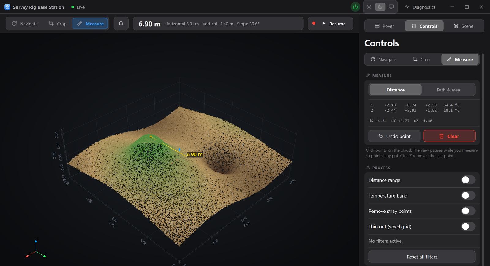
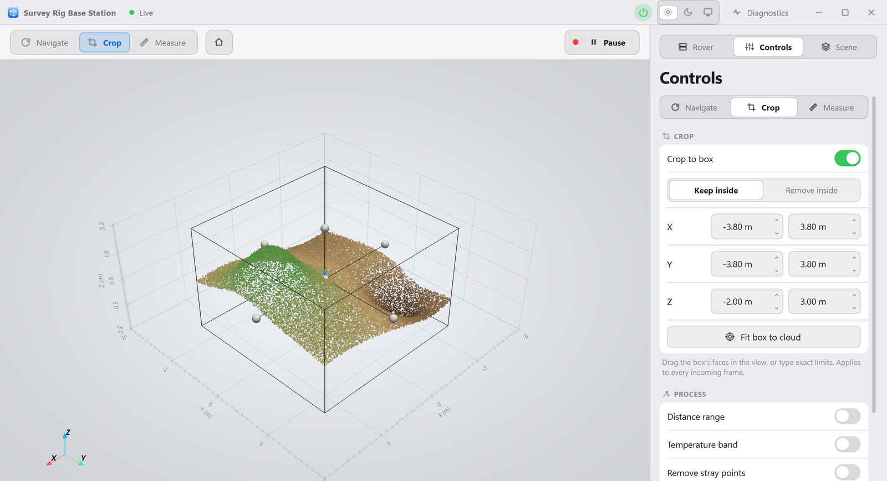

# Ground Station 3D

Desktop base station for a mine / landfill survey rig. It pulls the rover's live
RGB + thermal point cloud over WiFi, lets you crop, measure and filter it, and
can check on and power the sensor PC. Built on Qt (PySide6) and PyVista/VTK.



<details>
<summary>Light theme</summary>



</details>

## Features

- **Live 3D cloud** with RGB or thermal colouring, scale grid, origin and orientation axes, and a Home button for the default view
- **Crop** with a draggable 3D box or exact limits; **Measure** distance, slope, path length and plan-view area, with the temperature at each point
- **Process** every frame live: distance range, temperature band, stray-point removal, voxel thinning (saves and recordings use the result)
- **Sensor diagnostics**: camera / thermal / lidar connection and fps, pipeline health, and Pi vitals including under-voltage
- **Power button**: start, stop or restart the sensor pipeline, or power the Pi off (with a warning that it must then be power-cycled by hand)
- **Scan for senders** on the local network, **record** frames on an interval, **save** clouds and screenshots
- **Light, Dark or System** appearance (toggle in the title bar)

## Quick start

```bash
python -m venv .venv
.venv\Scripts\activate          # Windows
pip install -r requirements.txt
python -m basestation           # or double-click "Run Base Station.bat"
```

Press **Scan for senders**, pick the rover, then **Connect**. Python 3.10+.

No rig? Run a stand-in and connect to `127.0.0.1`:

```bash
python tools/mock_rover_server.py --scene terrain --token demo
```

It serves a cloud, simulated diagnostics, and the real control daemon over a fake systemd.

## Sensor PC

The rig is [PitFusion3D](https://github.com/VishAndChips1/PitFusion3D) (ROS 2 on a Raspberry Pi). Diagnostics and power control need a small addition there; see [`sensor_side/README.md`](sensor_side/README.md) (one `git apply`, one install script). Without it, everything else still works.

## Layout

```text
basestation/
  app.py        main window, tools, inspector
  core/         no-Qt logic: protocol, processing, diagnostics, control client, discovery
  ui/           theme (light/dark), widgets, icons, diagnostics window
  net/          Qt threads: polling, scanning, commands
  assets/       app icon
sensor_side/    Pi-side diagnostics + control daemon, and the patch for PitFusion3D
tools/          mock rover server
tests/          python -m unittest discover -s tests
data/           created at run time: recent hosts, crash log, captures (git-ignored)
```

## Protocol

`GET http://<rover>:<port>/latest.bin` returns one frame, little-endian: `uint32 N`, then `N x 7 float32` (`x y z r g b thermal`; metres, RGB already 0-1, thermal in Kelvin or NaN). Only `basestation/core/protocol.py` parses it, so a format change touches one file.

Trusted LAN only: no authentication or encryption on the point-cloud feed.
